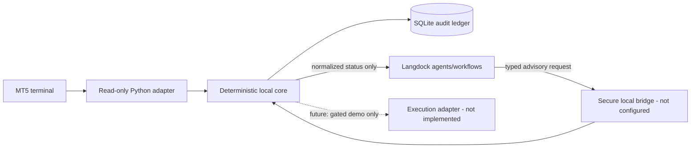

# ARCHITECTURE — ALPHA TRADER AI MT5

**الحالة:** التصميم مقترح؛ المحوّل الحالي فقط read-only prototype.

## الحدود
- MT5 على Windows + Python محلي: مصدر بيانات الحساب والسوق وخصائص الرمز.
- Core حتمي محلي: normalization، فحص جودة البيانات، sizing، risk، persistence، reconciliation.
- Langdock: orchestration، معرفة، تحليل وتقارير؛ مخرجاته اقتراحات غير موثوقة حتى يتحقق منها core محلي.
- MQL5 EA اختياري لاحقاً، وما يكونش مسار تجاوز لبوابة المخاطر.

## المحوّل الحالي
`alpha_mt5/readonly.py` كيقرا terminal/account health، symbol specs، آخر tick وbars تاريخية. ما كياخدش credentials وما عندوش دوال إرسال/تعديل/إغلاق. كيتلقى MT5 API بالحقن، باش الاختبارات تكون offline وبلا تثبيت MetaTrader5 فبيئة الاختبار.

## قواعد الداتا
- timestamps كيتحوّلو لـUTC.
- القيم الناقصة كتظل `None`؛ ما كاينش تخمين لخصائص الرمز.
- قيم float غير محدودة بحال NaN/Inf كتتحول لـNone.
- هذا ماشي بحد ذاتو freshness/risk validator؛ أي مستهلك خاصو يتحقق من العمر والاكتمال والحدود قبل استعمال البيانات.
- رصيد الحساب ما خاصوش يخرج لـLangdock إلا بضرورة وبموافقة وسياسة data minimization.

## مسار التطوير
1. schemas versioned لـQuote/SymbolSpec/Account/intent.
2. unit/contract tests لـrisk وMT5 sizing من خصائص الوسيط الفعلية.
3. SQLite/audit log، kill switch وdata freshness gates.
4. scanner وstrategy plans paper-only.
5. mock executor، ثم demo integration بعد موافقة المستخدم.

## Bridge
ما كاينش bridge ولا endpoint مهيأ. ما نفتحوش MT5 على الإنترنت؛ أي bridge مستقبلي خاصو TLS/auth، allow-listed typed actions، nonce/idempotency، rate limits، local revalidation، وما يقبلش shell أو كود عن بعد.