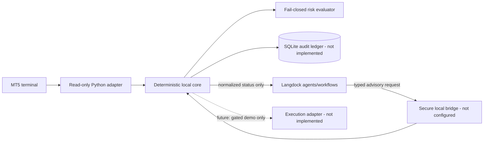

# ARCHITECTURE — ALPHA TRADER AI MT5

**الحالة:** التصميم مقترح؛ المحوّل وبوابة المخاطر الأولية فقط تدارو.

## الحدود
- MT5 على Windows + Python محلي: مصدر بيانات الحساب والسوق وخصائص الرمز.
- Core حتمي محلي: normalization، فحص جودة البيانات، sizing، risk، persistence، reconciliation.
- Langdock: orchestration، معرفة، تحليل وتقارير؛ مخرجاته اقتراحات غير موثوقة حتى يتحقق منها core محلي.
- MQL5 EA اختياري لاحقاً، وما يكونش مسار تجاوز لبوابة المخاطر.

## المحوّل الحالي
`alpha_mt5/readonly.py` كيقرا terminal/account health، symbol specs، آخر tick وbars تاريخية. ما كياخدش credentials وما عندوش دوال إرسال/تعديل/إغلاق. كيتلقى MT5 API بالحقن، باش الاختبارات تكون offline وبلا تثبيت MetaTrader5 فبيئة الاختبار.

## بوابة المخاطر الأولية
`alpha_mt5/risk.py` كتراجع proposal وcontext وlimits معطاة ليها: terminal connection، broker-spec flag، freshness، spread، stop geometry، loss estimate بعملة الحساب، daily P/L، عدد الصفقات، duplicate، ووضع `DEMO_PROPOSAL`. إذا مدخل ناقص/غير صالح كترد BLOCK. `PASS` يعني اجتياز هاد التقييم المحدود فقط؛ `execution_authorized` دائماً false. ما كتحسبش volume، وما كتجبدش loss estimate بنفسها؛ خاص ربطها لاحقاً بمصدر موثوق من MT5 واختبار مستقل.

## قواعد الداتا
- timestamps خاصها تكون timezone-aware وكتتحول/تتفسر كـUTC.
- القيم الناقصة كتظل `None`؛ ما كاينش تخمين لخصائص الرمز.
- قيم float غير محدودة بحال NaN/Inf كتعتبر invalid.
- هذا ماشي بحد ذاتو نظام production للـfreshness/risk؛ المستهلك خاصو يتحقق من العمر والاكتمال والحدود قبل أي استعمال.
- رصيد الحساب ما خاصوش يخرج لـLangdock إلا بضرورة وبموافقة وسياسة data minimization.

## مسار التطوير
1. schemas versioned لـQuote/SymbolSpec/Account/intent.
2. ربط risk evaluator بمصادر محلية موثوقة؛ بناء sizing باستخدام حساب MT5 account-currency.
3. اختبارات contract على terminal demo، ثم SQLite/audit log، kill switch وdata freshness gates.
4. scanner وstrategy plans paper-only.
5. mock executor، ثم demo integration بعد موافقة المستخدم.

## Bridge
ما كاينش bridge ولا endpoint مهيأ. ما نفتحوش MT5 على الإنترنت؛ أي bridge مستقبلي خاصو TLS/auth، allow-listed typed actions، nonce/idempotency، rate limits، local revalidation، وما يقبلش shell أو كود عن بعد.